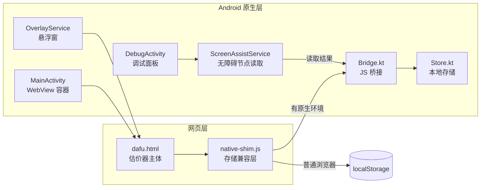

<div align="center">

# 🎯 达芙拍卖估价器

**《异环》拍卖场景的离线估价辅助工具 · Android 版**


[功能特性](#-功能特性) · [实现原理](#-实现原理) · [快速开始](#-快速开始) · [项目结构](#-项目结构) · [⚠️ 免责声明](#️-免责声明)

</div>

---

## ✨ 功能特性

| 模块 | 说明 |
| :--- | :--- |
| 💰 **拍卖估价与反推** | 沿用网页版的估价与反推算法，辅助分析藏品组合与估价结果 |
| 🪟 **悬浮窗** | 可叠加在其他应用之上显示估价页面，支持拖动、缩放，边看拍卖界面边使用 |
| 💾 **本地数据** | 主界面与悬浮窗共享同一份本地数据，全部保存在设备本地 |
| 🔍 **屏幕辅助** | 通过无障碍服务读取前台应用公开的界面文本，支持手动与定时读取 |
| 🛠️ **调试面板** | 集中查看无障碍连接状态、悬浮窗权限、读取结果与运行日志 |
| 🌐 **网页兼容** | 核心页面可独立作为普通 HTML 运行，无原生环境时自动回退到 `localStorage` |

---

## 🧠 实现原理

### 1. 整体架构

核心估价逻辑保留为一个独立的 HTML/JS 页面，Android 只负责"外壳"：提供窗口、存储、系统权限和屏幕读取能力。



### 2. 网页与原生的通信

- **WebView 承载**：`MainActivity` 加载 `assets/dafu.html`，网页内容无需改写即可运行。
- **JavaScript Bridge**：`Bridge.kt` 向网页注入原生接口，网页通过它读写数据、请求悬浮窗或读取屏幕文本。
- **存储兼容层**：`native-shim.js` 统一了两套存储接口。在 Android 中走 `Store.kt` 的本地存储；在普通浏览器中回退到 `localStorage`，因此同一份页面两种环境都能运行。

### 3. 悬浮窗

- `OverlayService` 以前台服务的形式运行，通过系统的"显示在其他应用上层"权限绘制悬浮窗口。
- 悬浮窗内嵌同一个 WebView 页面，因此与主界面共享数据，无需单独同步。
- 拖动与缩放由原生触摸事件处理，窗口位置与尺寸在会话之间保留。

### 4. 屏幕辅助（无障碍节点读取）

`ScreenAssistService` 继承 `AccessibilityService`，其工作方式如下：

1. 收到读取指令（手动或定时）后，获取当前前台窗口的 `AccessibilityNodeInfo` 树；
2. 深度优先遍历节点，收集其中公开的文本与内容描述；
3. 将结果与节点数量通过 Bridge 回传给网页，并写入调试日志。

> **关键限制**：读取效果取决于游戏界面是否向系统公开可访问节点。如果界面由 Canvas、SurfaceView 或自绘图形渲染，系统看不到文字节点，读取结果会为空。这是 Android 无障碍机制本身的边界，而非本项目可以绕过的问题。

### 5. 屏幕捕获（实验性）

项目已能发起 `MediaProjection` 屏幕捕获授权请求，并能获取截图帧；**截图之后的 OCR 文字识别流程尚未完成**。在此之前，屏幕辅助仅限于上面的无障碍文本读取。

### 6. 估价算法

估价与反推逻辑直接沿用网页版，本项目没有另起一套算法，也未改变原有的计算规则。如需了解具体计算方式，请参阅 `dafu.html` 中的源码。

---

## 🚀 快速开始

### 构建 APK

1. 使用 **Android Studio** 打开项目，等待 Gradle 同步完成（首次需联网下载依赖）。
2. 菜单选择：`Build → Build Bundle(s) / APK(s) → Build APK(s)`
3. Debug 包输出位置：`app/build/outputs/apk/debug/`

### 首次使用

| 步骤 | 操作 |
| :---: | :--- |
| 1 | 启动应用，按提示授予**悬浮窗权限** |
| 2 | 开启悬浮窗，拖动悬浮球即可展开或收起估价页面 |
| 3 | *（可选）* 在调试面板中开启**无障碍服务**，再尝试手动读取 |
| 4 | 若读取为空，先在日志中查看节点数量与内容，确认是否为渲染问题 |

> 💡 不同厂商的 ROM 对后台运行、悬浮窗和无障碍服务限制各不相同，如功能异常请检查系统设置中的自启动与电池优化选项。

### 直接使用网页版

无需安装 Android 应用，用浏览器打开 `dafu.html` 即可使用全部估价功能（数据保存在浏览器的 `localStorage` 中）。

---

## 📁 项目结构

```
app/src/main/
├── assets/
│   ├── dafu.html            # 估价器主体（网页版）
│   └── native-shim.js       # 网页存储与原生存储的兼容层
└── java/.../
    ├── MainActivity.kt      # 主界面与 WebView 容器
    ├── OverlayService.kt    # 悬浮窗服务
    ├── ScreenAssistService.kt  # 无障碍节点读取服务
    ├── DebugActivity.kt     # 屏幕辅助调试面板
    ├── Bridge.kt            # JS ↔ 原生通信
    ├── WebSetup.kt          # WebView 初始化配置
    └── Store.kt             # 本地数据存储
```

---

## 🔄 GitHub Actions

若仓库已配置自动构建工作流，可在 **Actions** 页面查看构建记录，并从对应运行记录的 **Artifacts** 下载 APK。是否自动发布 Release 以工作流当前配置为准。

---

## ⚠️ 免责声明

请在使用本项目前仔细阅读以下内容。**继续使用即视为你已理解并同意以下条款。**

1. **非官方工具**：本项目是由玩家制作的第三方辅助工具，与《异环》的开发者、发行商及其关联公司**没有任何隶属、授权或合作关系**。文中提及的游戏名称及相关商标均归其各自权利人所有。

2. **仅供参考**：估价结果基于网页版的既有算法给出，属于辅助参考，**不保证准确性、完整性或时效性**。拍卖决策及由此产生的游戏内外损失，由使用者自行承担。

3. **不做自动操作**：本项目不实现也不承诺后台自动出价、自动点击或无人值守操作。任何出价行为均应由用户本人确认完成。

4. **游戏规则风险**：读取游戏界面、使用无障碍服务或悬浮窗等行为，可能违反游戏的用户协议或公平性规定。因使用本项目导致的账号限制、封禁、数据丢失等后果，**与本项目作者无关**，请自行评估风险。

5. **权限与隐私**：应用需要悬浮窗与无障碍权限。无障碍服务能够读取前台界面的文本内容，请仅在理解其用途的前提下开启，并在不需要时及时关闭。本项目不主动上传任何数据，所有估价数据均保存在本地设备。

6. **屏幕捕获未完成**：屏幕捕获相关代码仅为实验性功能，OCR 识别流程尚未完成，请勿依赖其结果。

7. **无担保**：本项目按"现状"提供，不附带任何明示或暗示的担保，包括但不限于适销性、特定用途适用性及不侵权的担保。作者不对因使用或无法使用本项目而产生的任何直接或间接损失负责。

8. **版权与再分发**：如需二次分发、修改或商用，请先确认相关素材与游戏内容的授权情况。

---

<div align="center">

如果这个项目对你有帮助，欢迎 ⭐ Star 支持。

</div>
